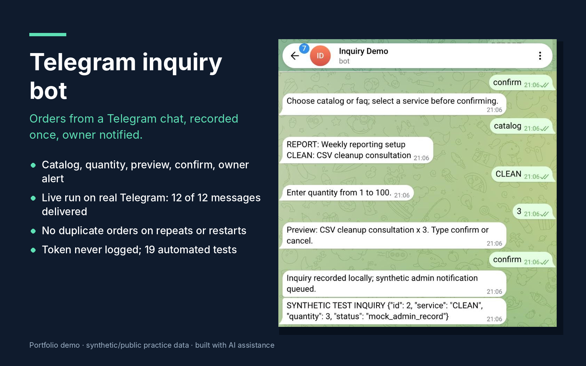
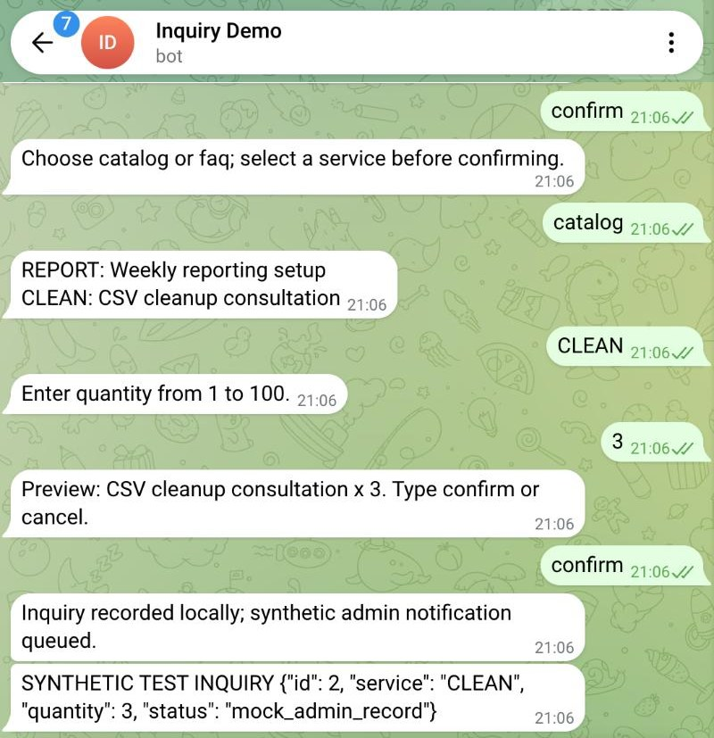

# Telegram inquiry bot with a safe delivery log

A small business bot: the customer picks a service from the catalog, enters a quantity, sees a preview and confirms. The inquiry is recorded and the owner gets a notification in Telegram. This single-runner demo stores every processed update, so a repeated message or a restart does not create a duplicate inquiry, and a send that was interrupted is never retried blindly: it waits for a manual check.



## Live run on real Telegram (15.11.2026)

Dedicated test bot, real Telegram Bot API ([full log](evidence/live-telegram-run.md)):

- full flow: catalog → service → quantity → preview → confirm → owner notification;
- a second `confirm` did **not** create a duplicate inquiry;
- database after the run: 10 updates recorded, 12 outbox messages `delivered`, 0 `uncertain`, 2 inquiries.

This was a happy-path run. Crash and restart behaviour is covered by local tests with a fake Telegram API, not by the live run.

## What makes it reliable

- **Every update is stored before replying** (SQLite), so an update that was already recorded is not processed again after a restart.
- **Outbox with states:** a message is marked *uncertain* before sending and *delivered* after; if a run stops in between, the next run makes no API calls until someone checks the chat. Exactly-once delivery is not claimed.
- **Recipient allowlist:** the bot can only write to approved chats.
- **Secrets stay secret:** the token is read from the environment and never printed or logged; HTTP errors are redacted; redirects are disabled; system proxies are ignored unless `TELEGRAM_USE_ENV_PROXY=1` (use only a proxy you trust).
- **22 automated tests**, including a simulated crash right after a fake Telegram API accepts a message: `python3 -m unittest discover -v`.

## Run it

```sh
python3 bot.py                          # offline simulator in the terminal, no Telegram needed
export TELEGRAM_BOT_TOKEN=...           # token of a dedicated test bot
python3 live_once.py --live --test-chat <your chat id> --admin-chat <your chat id>
# behind a proxy: TELEGRAM_USE_ENV_PROXY=1 python3 live_once.py ...
```

Limits: one runner per bot, polling only, no groups, payments or load testing.

Standard library only. The same structure fits order intake, booking requests, lead capture or support triage; a production version would add a long-running poller or webhook and real storage of inquiries (CRM, Google Sheets).

<details>
<summary>Technical details and limits (for developers)</summary>

### Offline simulator

Python 3.12, standard library only, no pip requirements:

```sh
python3 bot.py
python3 bot.py < examples/conversation.txt
python3 -m unittest discover -v
```

Type `catalog`, `REPORT` or `CLEAN`, a quantity from 1 to 100, then `confirm`. `faq` preserves the current selection; `cancel` or `/start` resets it. Selecting a new service discards the previous draft. Repeating confirm after a successful submission adds no second log entry. `quit` prints the mock log. `examples/expected-transcript.txt` is actual output from the supplied conversation.

### Architecture and limits

`Bot.reply(session, text)` separates conversation logic from transport; sessions are independent. `telegram_payload` accepts private text Update-shaped dictionaries and returns sendMessage-shaped parameters. This mapping makes no HTTP calls. Offline simulator state disappears on exit; the separate real transport and persistent runner are described below. This is a single-process local demo with no production concurrency or durability guarantees. Never enter personal data in this demonstration.

Future real testing requires secure token provisioning, owner-approved test recipients and authorization for a live test. The local simulator does not read environment credentials. Official API: https://core.telegram.org/bots/api

`evidence/current-tests.txt` shows current local checks; `evidence/review-final.md` records the review. `cover.png` is a portfolio concept cover, and `evidence/transcript.png` renders an actual offline transcript, not a Telegram screenshot.

### Real transport

`telegram_transport.py` provides getMe/getUpdates/sendMessage via the fixed HTTPS Telegram host. It disables redirects and ignores proxies unless `TELEGRAM_USE_ENV_PROXY=1`, limits responses, redacts transport errors and requires an explicit recipient allowlist. Tests inject fake responses: no network or valid credentials.

`recovery.py` transactionally stores dialogue state, processed update IDs and an outbox in SQLite. Duplicate updates are ignored across restarts. `live_once.py` requires `--live` and explicit test/admin chat IDs; it performs one poll of up to 20 updates. A live run was made on 15.11.2026 (see evidence/live-telegram-run.md). SQLite errors stop cleanly without a traceback. Uncertain previous deliveries block all network calls.

Outgoing messages are marked uncertain before sending, and delivered after success. Failures or crashes may leave uncertainty, including a crash before sending. There is no automatic resend: reconcile with the recipient before proceeding. Exactly-once remote delivery is not guaranteed. Use only one runner on a dedicated test bot without a webhook or another poller. getUpdates advances the bot-wide update stream, even for chats this demo ignores; never use a shared production bot.

Persistent state includes synthetic messages, chat IDs, processed IDs and outbox records, not tokens. It remains until manually removed. The live runner creates files with restrictive umask; do not package state databases. Trusted stable local filesystem and one process only. No automatic retention cleanup, production deployment or automated uncertainty resolution.

### Minimal authorization for E2E

Select an existing dedicated test bot, or separately approve creating one. Confirm its identity and absence of other pollers/webhooks. Approve the exact private test and admin chats (they may be the same owner-controlled chat), then approve secure token provisioning. Never paste a token into conversation. Each recipient must first start the bot. No group-admin privileges, payments or broadcast permissions are required.

Only after confirmation authorize getMe and bounded polling/replies for this synthetic sequence: catalog, REPORT, 2, confirm, repeat confirm, restart and check no duplicate inquiry. Keep redacted evidence of test identity, timestamps, received messages and restart behavior. Basic methods here do not request paid broadcast features. Local tests do not prove actual delivery.

### Verified send/status failure boundary

The outbox commits `uncertain` before calling sendMessage. If the remote accepts a message but the subsequent `delivered` write fails, the persisted state stays uncertain. On restart the runner stops before any API call; the delivery routine never selects uncertain rows for automatic resend. Two regression tests cover an actual SQLite trigger abort on the final status update and abrupt child-process exit after fake remote acceptance. Both use synthetic local doubles, not Telegram.

This deliberately favors manual reconciliation over blind retries. It cannot establish whether an uncertain message reached Telegram and does not promise exactly-once delivery, power-loss durability or safe concurrent runners. Review with the intended recipient before any manual state change. Do not reset the database merely to retry.

</details>

---
Portfolio demo with synthetic services, built with AI assistance. No real customers or payments.
